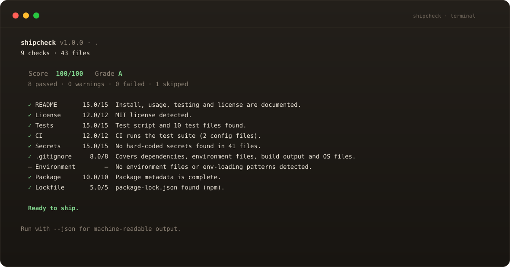

# Shipcheck

**Does your repository look ready to ship?**

Shipcheck is a zero-dependency Node CLI that audits the things a stranger sees
first: the README, license, tests, CI, hard-coded secrets, `.gitignore`,
environment hygiene, package metadata and lockfiles. It gives you a score, a
letter grade and the specific fixes that move the number.



[](https://github.com/pkaycodes/shipcheck/actions/workflows/ci.yml)
[](LICENSE)
[](package.json)
[](package.json)

## Quick start

Requires Node.js 20 or newer. There is nothing else to install: the package has
no runtime dependencies.

```bash
npm install -g github:pkaycodes/shipcheck
shipcheck .
```

Or run it from a clone:

```bash
git clone https://github.com/pkaycodes/shipcheck.git
cd shipcheck
npm install
node bin/shipcheck.js /path/to/repository
```

The package is prepared for npm as `@pkaycodes/shipcheck`; once a release is
published, `npm install -g @pkaycodes/shipcheck` will work too.

## What it checks

| Check | Weight | Looks for |
| --- | ---: | --- |
| README | 15 | A real front page: title, install, usage, tests, license and an example |
| License | 12 | A recognised LICENSE file, and a matching `license` field |
| Tests | 15 | Test files and a runnable test script |
| CI | 12 | A CI config that actually runs the tests |
| Secrets | 15 | Private keys, provider tokens and hard-coded credentials |
| `.gitignore` | 8 | Dependencies, build output, coverage, env files, logs and OS files |
| Environment | 8 | `.env` hygiene and a documented `.env.example` |
| Package | 10 | Name, version, description, license, repository, engines and files |
| Lockfile | 5 | A single lockfile that matches the declared package manager |

Checks that do not apply — for example the package and lockfile checks in a
Python repository — are skipped and removed from the denominator, so they
never count against the score.

## Usage

```text
shipcheck [path] [options]
```

| Option | Purpose |
| --- | --- |
| `--json` | Print a machine-readable JSON report |
| `--fail-under <score>` | Exit 1 when the score is below the threshold (0–100) |
| `--strict` | Exit 1 on any warning or failure |
| `--verbose` | Show details for every check, not just warnings and failures |
| `--no-color` | Disable ANSI colour |
| `--list-checks` | List check ids and weights |
| `-h`, `--help` | Show help |
| `-v`, `--version` | Print the version |

```bash
shipcheck .                          # audit the current directory
shipcheck ../my-app --fail-under 80  # make CI fail below 80
shipcheck . --json > report.json     # save a machine-readable report
shipcheck . --strict                 # warnings are failures too
```

Exit codes: `0` for a completed audit that meets the threshold, `1` when the
score is below `--fail-under` or `--strict` found warnings/failures, and `2` for
invalid usage or an unreadable path.

## The report

```text
shipcheck v1.0.0 · .
9 checks · 43 files

  Score  100/100   Grade A
  8 passed · 0 warnings · 0 failed · 1 skipped

  ✓ README       15.0/15  Install, usage, testing and license are documented.
  ✓ License      12.0/12  MIT license detected.
  ✓ Tests        15.0/15  Test script and 10 test files found.
  ✓ CI           12.0/12  CI runs the test suite (2 config files).
  ✓ Secrets      15.0/15  No hard-coded secrets found in 41 files.
  ✓ .gitignore     8.0/8  Covers dependencies, environment files, build output and OS files.
  – Environment        —  No environment files or env-loading patterns detected.
  ✓ Package      10.0/10  Package metadata is complete.
  ✓ Lockfile       5.0/5  package-lock.json found (npm).

  Ready to ship.
```

Scores map to letter grades: **A** 90–100, **B** 80–89, **C** 70–79, **D** 60–69,
**F** below 60. The score is a weighted average, not a checklist of everything
a project could possibly have. It is meant to point at the next useful fix.

## JSON output

`--json` keeps stdout pure JSON, so it can be piped into a dashboard or another
script. Check-level `score` is a ratio from 0 to 1; the top-level `score` is the
weighted percentage.

```json
{
  "tool": "shipcheck",
  "schemaVersion": 1,
  "version": "1.0.0",
  "root": "/home/you/project",
  "score": 84,
  "grade": "B",
  "summary": { "passed": 6, "warnings": 1, "failed": 1, "skipped": 1 },
  "checks": [
    {
      "id": "ci",
      "title": "CI",
      "weight": 12,
      "score": 0.6,
      "points": 7.2,
      "status": "warn",
      "summary": "CI found, but it does not run the test suite.",
      "details": [".github/workflows/build.yml"],
      "fix": "Add the test command to .github/workflows/build.yml."
    }
  ]
}
```

## GitHub Action

Shipcheck ships as a GitHub Action. Check out the repository first; the action
reads the workspace and does not need any dependencies installed.

```yaml
name: Shipcheck

on: [push, pull_request]

jobs:
  audit:
    runs-on: ubuntu-latest
    steps:
      - uses: actions/checkout@v7
      - uses: pkaycodes/shipcheck@v1
        with:
          fail-under: 80
```

Inputs: `path` (default `.`), `fail-under` (default `70`) and `strict` (default
`false`). Outputs: `score`, `grade`, `passed`, `warnings`, `failed` and
`skipped`. Failures and warnings also appear as annotations in the workflow log.

In any other CI, run the CLI directly:

```bash
node bin/shipcheck.js . --fail-under 80
```

## How it works

Shipcheck walks the repository once, reads text files, and applies small,
readable heuristics. It never executes the code it audits, never writes to the
repository, and makes no network requests. The secret scanner looks for
well-known token formats and common credential assignments, stops at 600 files
and 512 KB per file, and redacts every match in its output.

The secret patterns are a safety net, not a replacement for GitHub secret
scanning, `gitleaks`, or a real security review. A clean Shipcheck report means
"no obvious shipping blockers", not "secure".

## Design principles

- **Zero dependencies.** The published package has no runtime dependencies and
  no install scripts. Nothing is fetched or executed at runtime.
- **Local and read-only.** No telemetry, no accounts, no network. The audit is
  deterministic and safe to run on any checkout.
- **Actionable.** Every warning or failure comes with a concrete next step.
- **Honest about scope.** File and content heuristics are deliberately simple.
  Monorepos, generated code and unusual layouts may need human judgement.

## Development

```bash
git clone https://github.com/pkaycodes/shipcheck.git
cd shipcheck
npm install
npm test                       # node:test suite
node bin/shipcheck.js .        # audit Shipcheck with Shipcheck
npm pack --dry-run             # inspect the published tarball
```

The tests cover each check, the scoring model, the text and JSON reporters, the
CLI exit codes, and the GitHub Action outputs.

## Releasing

The package is npm-ready. To publish a release:

1. Bump `version` in `package.json`.
2. Add an `NPM_TOKEN` repository secret with publish access to
   `@pkaycodes/shipcheck`.
3. Tag and push: `git tag v1.0.0 && git push origin v1.0.0`.

The release workflow runs the tests, checks the tarball and publishes with npm
provenance. Move the `v1` tag when the action should point at the new release.

## License

[MIT](LICENSE) © 2026 Papakwame Afrifa Mensa
